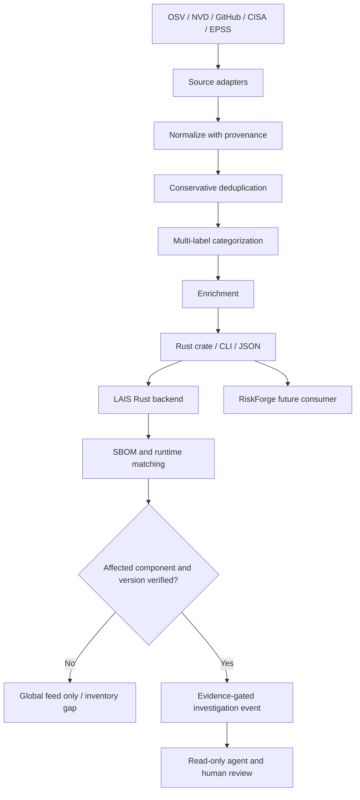

# Architecture decision

## Boundaries

- No AI is used for collection, normalization, or categorization.
- A component version match does not prove reachability or exploitability.
- Unknown component versions remain unknown, never safe.
- Keep all source identifiers, URLs, timestamps and original source records.
- Do not deduplicate by title similarity. Alias resolution requires validated identity mappings.
- Categories are multiple tags per canonical advisory, not duplicate records.
- Network, storage, scheduling and credentials stay outside the portable core.
- RiskForge tenant inventory and authorization must remain isolated.
